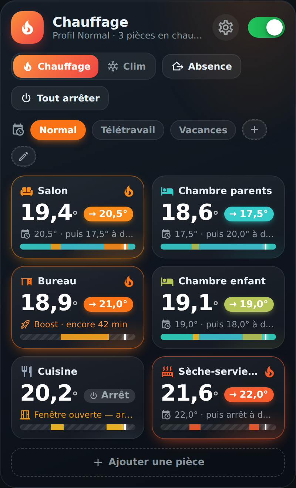
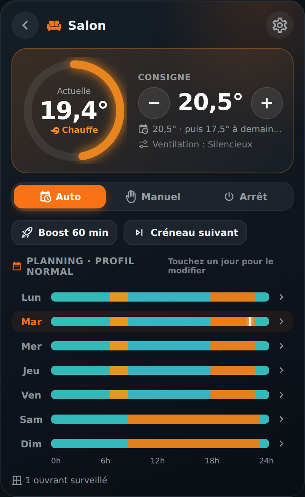
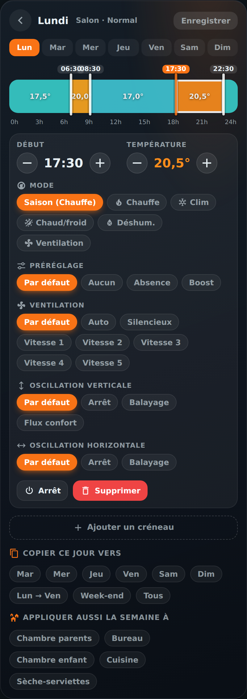
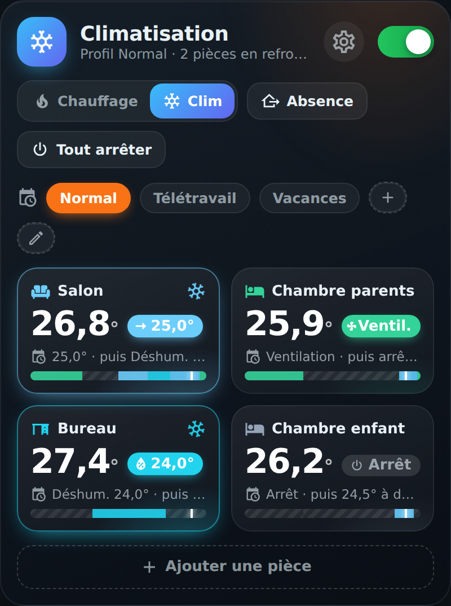
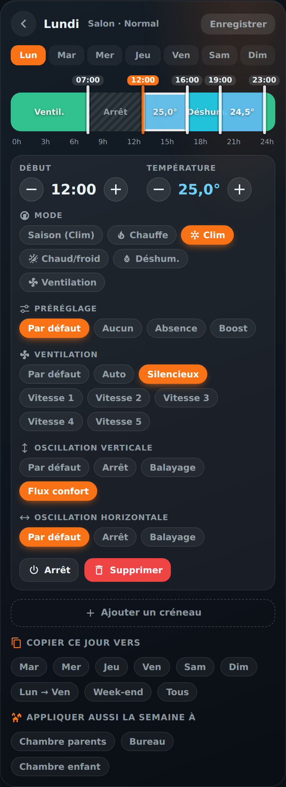

# 🌡️ Climat HOLM

[](https://hacs.xyz/)


[🇫🇷 Français](README.md) · 🇬🇧 English

**Heating and air conditioning for the whole home, scheduled room by room, in one clear, animated card.**

Climat HOLM is a **Home Assistant** integration that drives your heaters, heat pumps, air conditioners and towel rails (any `climate` entity) from a **schedule per room**. It comes with **its own Lovelace card**: you see the whole home at a glance, change a time by dragging a handle, start a boost with a tap.

> ✨ **Zero YAML.** Add the integration, create your rooms from the card, and set everything with your finger: times, temperatures, modes, fan, profiles.

### At a glance

- 👀 **See at a glance**: one tile per room with the current temperature, the setpoint, what's happening (“20.5° · then 17.5° at 22:30”), the day's timeline and an animation while heating or cooling.
- ✍️ **Edit easily**: a 0–24 h timeline per day; drag the handles (5-min steps), set start and end to the quarter hour, tap a range to set its temperature, copy a day to other days or other rooms.
- ❄️ **Heating and A/C**: a Heating / A/C season switch, and each slot can force its **mode** (heat, cool, heat/cool, dry, fan only).
- 🌀 **Device options**: fan (auto, quiet, speeds), vertical and horizontal swing, preset (eco, comfort, boost…), per room or per slot. The card only offers what your devices can do.
- ⚡ **Quick actions**: Boost, Next slot, Back to schedule, Auto / Manual / Off mode, and for the whole home: Away and Stop everything.
- 🗂️ **Profiles**: Normal, Working from home, Holidays… a full schedule per profile, switched with a tap.
- 🪟 **Windows**: a room stops automatically when a window stays open (adjustable delay).
- 🌡️ **Sensor of your choice**: a room's temperature can come from a more reliable sensor than the heater's.
- 🤖 **Ready for your automations**: a thermostat per room, switches, selects and actions (services).
- 🔁 **Import from Climate Scheduler**: your existing schedules are taken over in one click.
- 🌍 **8 languages**: English, French, German, Spanish, Italian, Dutch, Portuguese and Polish (integration and card).

| Overview | A room | A day |
|---|---|---|
|  |  |  |

| A/C season | A slot's mode and options |
|---|---|
|  |  |

*Screenshots in French — the card follows the language of your Home Assistant profile.*

### 🆕 What's new in 1.2.0

- 🌍 **8 languages**: the integration (setup, options, entities, actions) is translated into English, French, German, Spanish, Italian, Dutch, Portuguese and Polish, following the language of Home Assistant. The **HOLM Climat** card too, editor included; its `language` option lets you force a language.
- 🇬🇧 English README.

---

## Contents

- [Installation](#installation)
- [Getting started](#getting-started)
- [The card](#the-card)
- [Who decides the setpoint?](#who-decides-the-setpoint)
- [Entities created](#entities-created)
- [Actions (services)](#actions-services)
- [Settings](#settings)
- [FAQ / troubleshooting](#faq--troubleshooting)

---

## Installation

### With HACS (recommended)

1. HACS → ⋮ menu → **Custom repositories**.
2. Add `https://github.com/kaaribou/climat-holm`, category **Integration**.
3. Search for **Climat HOLM** → **Download**.
4. **Restart Home Assistant.**

### Manually

1. Copy the `custom_components/climat_holm` folder into Home Assistant's `config/custom_components/` folder.
2. Restart Home Assistant.

> [!NOTE]
> The card **comes with the integration**: no need to install it separately or to add a resource, it is registered automatically.

---

## Getting started

1. **Settings → Devices & services → Add integration → Climat HOLM.**
2. Optionally choose your devices (one room is created per device) and, if you use Climate Scheduler, tick **Import my schedules**.
3. Leave **“Turn scheduling on right away”** unticked if you want to check everything first: while scheduling is paused, Climat HOLM **controls no device**.
4. Add the **Climat HOLM** card to a dashboard from the card picker:

```yaml
type: custom:holm-climat-card
```

5. Create or adjust your rooms and schedules in the card, then turn scheduling on with the switch at the top right.

> [!IMPORTANT]
> One scheduler at a time: if another tool (Climate Scheduler, automations, the device's built-in schedule…) already drives the same devices, turn it off so they don't contradict each other.

---

## The card

### Overview

- Header: season, scheduling state, **Settings** button and **Scheduling** switch.
- **Heating / A/C**: changes the season, hence the mode used by default by all slots.
- **Away**: every room goes to the away temperature (and the A/C stops, if you wish).
- **Stop everything**: general stop, without touching the schedules.
- **Profiles**: tap a profile to activate it; **+** creates a profile (copy of the active one), ✏️ renames or deletes it.
- One tile per room; a tap opens the room.

### A room

- Temperature gauge, **setpoint +/-**: the new setpoint lasts until the next slot, then the schedule resumes.
- **Auto** (schedule), **Manual** (fixed setpoint, with its own mode and options) or **Off**.
- **Boost** (adjustable duration), **Next slot**, **Back to schedule**.
- The week as timelines; tap a day to edit it. The cog opens the room settings: name, icon, devices, sensor, windows, device default options.

### A day

- **Drag the handles** to change the times (5-min steps), or set **Start** and **End** with − / + (to the quarter hour).
- Move from one slot to another with the ‹ › arrows of the panel (or ← → on the keyboard), handy for small slots. Tapping a handle also selects its slot.
- **Tap a range** to set its start and end time, its temperature or off, its **mode** and **options**: preset, fan, vertical and horizontal swing. “Default” uses the room's setting.
- **Add a slot** splits the chosen range (or the longest one) in two.
- **Copy this day to** other days (Mon → Fri, Weekend, All) and **Also apply the week to** other rooms.
- **Save**: nothing is sent until you save.

Each range shows its mode, setpoint and options (e.g. “Fan · Speed 1 · Swing”). On the timelines, the colour follows the temperature (blue → amber → red when heating) and the mode: blue for A/C, cyan for dry, green for fan, hatching for off.

### Card options

| Option | Description | Default |
|---|---|---|
| `language` | Card language: `fr`, `en`, `de`, `es`, `it`, `nl`, `pt`, `pl` | the profile's |
| `title` | Header title | Heating / Air conditioning |
| `rooms` | Limit the card to some rooms | all |
| `theme` | `auto`, `dark`, `light` or `theme` (your theme's colours) | `auto` |

---

## Who decides the setpoint?

For each room, the first rule that applies wins:

| Priority | Situation | Result |
|---|---|---|
| 1 | Scheduling paused | Climat HOLM touches nothing |
| 2 | **Stop everything** | Off |
| 3 | Window open for longer than the delay | Off |
| 4 | Room set to **Off** | Off |
| 5 | **Boost** running | Boost temperature |
| 6 | **Away** | Away temperature (or A/C off) |
| 7 | Room in **Manual** | Manual mode setpoint, mode and options |
| 8 | Temporary setpoint (+/-, next slot) | Until the next slot |
| 9 | Active profile's **schedule** | Current slot |

Climat HOLM only sends a command when something changes, and respects each device's limits (min / max temperatures, step, available modes and options).

---

## Entities created

| Entity | Role |
|---|---|
| `climate.holm_<room>` | Room thermostat: Auto / season / Off, setpoint, Boost preset. Attributes: source, override end, next change, open window, profile |
| `switch.climat_holm_programmation` | Turns all scheduling on / pauses it |
| `switch.climat_holm_absence` | Away mode |
| `switch.climat_holm_tout_arreter` | General stop |
| `select.climat_holm_profil` | Active profile |
| `select.climat_holm_saison` | Heating / Air conditioning |

*Entity IDs depend on the language Home Assistant had when the integration was added (French names shown here).*

## Actions (services)

| Action | Description |
|---|---|
| `climat_holm.boost` | Boost one or more rooms (`minutes`, 0 to stop) |
| `climat_holm.next_slot` | Skips to the next slot |
| `climat_holm.cancel_override` | Back to the schedule |
| `climat_holm.set_profile` | Changes profile |
| `climat_holm.set_away` | Turns away mode on / off (with an optional end date) |

Example: switch to the Holidays profile when leaving.

```yaml
action: climat_holm.set_profile
data:
  profile: Vacances
```

---

## Settings

From the card (⚙️) or **Settings → Devices & services → Climat HOLM → Configure**:

| Setting | Default |
|---|---|
| Boost temperature and duration | 21 °C · 60 min |
| Away temperature | 16 °C |
| Manual mode setpoint | 19.5 °C |
| Delay before stopping if a window is open | 60 s |
| Turn the A/C off while away | yes |

---

## FAQ / troubleshooting

| Problem | Solution |
|---|---|
| Nothing happens | Check that **scheduling** is on (switch at the top of the card). |
| A device doesn't follow the schedule | Another tool may also be driving it (device schedule, automation, other integration). |
| An option doesn't show | The card only shows the modes and options the device reports to Home Assistant. |
| A heater stops in A/C season | Normal: a device that can't cool is stopped in A/C season, unless the slot forces a mode it knows (Heat). |
| The new card version doesn't show | Clear the cache (Ctrl + F5, or “Reload resources” in the mobile app). |

---

## Say thanks?

Like the integration? You can buy me a beer 🍺

[](https://paypal.me/kaaribou)

---

## License

Code: **MIT** license — © kaaribou. See the [CHANGELOG](CHANGELOG.md) (in French).

Part of **HOLM — Home Orchestration & Living Management**: smart management and orchestration of the home.

Other projects: [Carburant HOLM](https://github.com/kaaribou/carburant-holm) · [Volets HOLM](https://github.com/kaaribou/volets-holm) · [HOLM HP/HC](https://github.com/kaaribou/holm-tarif) · [HOLM Lektrico](https://github.com/kaaribou/lektrico-holm) · [HOLM LaMetric](https://github.com/kaaribou/lametric-holm) · [HOLM My Menu](https://github.com/kaaribou/holm-mymenu) · [HOLM Cars](https://github.com/kaaribou/holm-cars) · [HOLM GitHub](https://github.com/kaaribou/github-holm) · [HOLM Navbar Card](https://github.com/kaaribou/holm-navbar-card) · [HOLM Climate Card](https://github.com/kaaribou/climate-card-holm) · [HOLM Music Card](https://github.com/kaaribou/holm-music-card) · [HOLM Energy Cards](https://github.com/kaaribou/holm-energy-cards) · [HOLM Power Flow Card](https://github.com/kaaribou/holm-power-flow-card) · [HOLM Ecojoko Card](https://github.com/kaaribou/holm-ecojoko-card) · [HOLM Runtime Card](https://github.com/kaaribou/holm-runtime-card) · [HOLM Covers Card](https://github.com/kaaribou/holm-covers-card) · [HOLM Floor Card](https://github.com/kaaribou/holm-floor-card) · [HOLM Radiator Card](https://github.com/kaaribou/holm-radiator-card) · [HOLM Security Card](https://github.com/kaaribou/holm-security-card) · [HOLM Sentinel Card](https://github.com/kaaribou/holm-sentinel-card) · [HOLM Recordings Card](https://github.com/kaaribou/holm-recordings-card) · [HOLM Smoke Card](https://github.com/kaaribou/holm-smoke-card) · [HOLM Family Card](https://github.com/kaaribou/holm-family-card) · [HOLM Govee Light Card](https://github.com/kaaribou/holm-govee-light-card) · [HOLM Leapmotor Card](https://github.com/kaaribou/holm-leapmotor-card).
