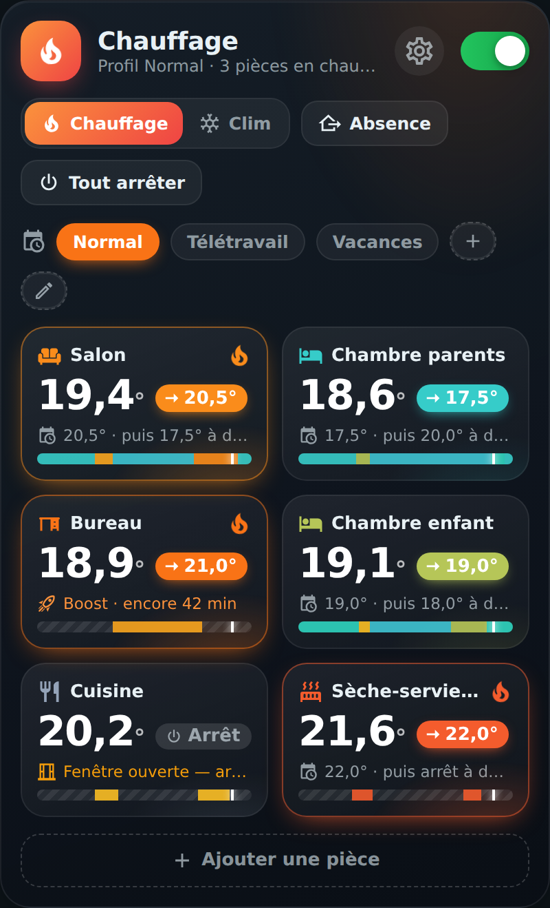
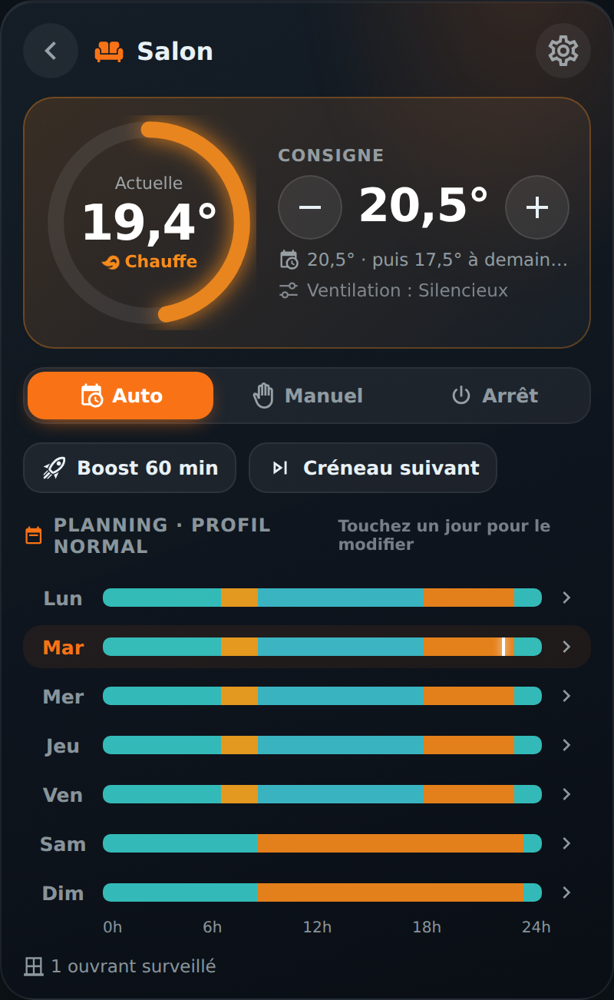
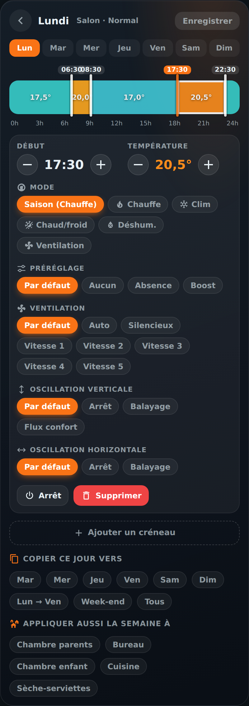
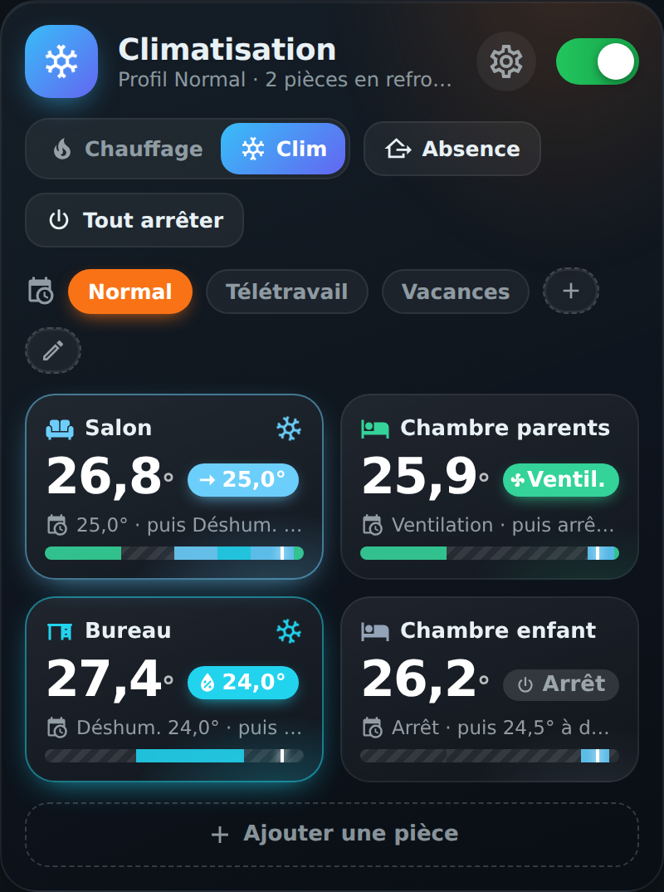
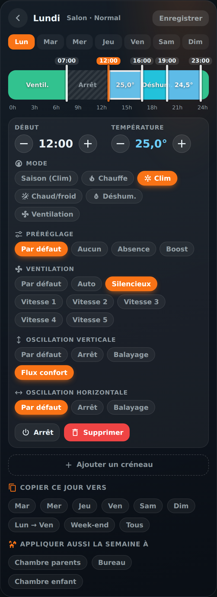

# 🌡️ Climat HOLM

[](https://hacs.xyz/)


**Le chauffage et la clim de toute la maison, programmés pièce par pièce, dans une seule carte claire et animée.**

Climat HOLM est une intégration **Home Assistant** qui pilote vos radiateurs, pompes à chaleur, climatiseurs et sèche-serviettes (toute entité `climate`) selon un **planning par pièce**. Elle est livrée avec **sa propre carte Lovelace** : on voit toute la maison d'un coup d'œil, on modifie un horaire en faisant glisser une poignée, on lance un boost d'un toucher.

> ✨ **Zéro YAML.** On ajoute l'intégration, on crée ses pièces depuis la carte, et tout se règle au doigt : horaires, températures, modes, ventilation, profils.

### En bref

- 👀 **Voir d'un coup d'œil** : une tuile par pièce avec la température actuelle, la consigne, ce qui se passe (« 20,5° · puis 17,5° à 22:30 »), la frise du jour et une animation quand ça chauffe ou refroidit.
- ✍️ **Modifier facilement** : une frise de 0 h à 24 h par jour ; on fait glisser les poignées (au quart d'heure), on touche une plage pour régler sa température, on copie une journée vers d'autres jours ou d'autres pièces.
- ❄️ **Chauffage et clim** : un interrupteur de saison Chauffage / Clim, et chaque créneau peut imposer son **mode** (chauffe, clim, chaud/froid, déshumidification, ventilation seule).
- 🌀 **Options des appareils** : ventilation (auto, silencieux, vitesses), oscillation verticale et horizontale, préréglage (éco, confort, boost…), par pièce ou par créneau. La carte ne propose que ce que vos appareils savent faire.
- ⚡ **Actions rapides** : Boost, Créneau suivant, Revenir au planning, mode Auto / Manuel / Arrêt, et pour toute la maison : Absence et Tout arrêter.
- 🗂️ **Profils** : Normal, Télétravail, Vacances… un planning complet par profil, qu'on bascule d'un toucher.
- 🪟 **Fenêtres** : arrêt automatique d'une pièce quand une fenêtre reste ouverte (délai réglable).
- 🌡️ **Sonde au choix** : la température d'une pièce peut venir d'un capteur plus fiable que celui du radiateur.
- 🤖 **Prêt pour vos automatisations** : un thermostat par pièce, des interrupteurs, des listes et des actions (services).
- 🔁 **Import depuis Climate Scheduler** : vos plannings existants sont repris en un clic.

| Vue d'ensemble | Une pièce | Une journée |
|---|---|---|
|  |  |  |

| Saison clim | Mode et options d'un créneau |
|---|---|
|  |  |

---

## Sommaire

- [Installation](#installation)
- [Premiers pas](#premiers-pas)
- [La carte](#la-carte)
- [Qui décide de la consigne ?](#qui-décide-de-la-consigne-)
- [Entités créées](#entités-créées)
- [Actions (services)](#actions-services)
- [Réglages](#réglages)
- [FAQ / dépannage](#faq--dépannage)

---

## Installation

### Avec HACS (recommandé)

1. HACS → menu ⋮ → **Dépôts personnalisés**.
2. Ajoutez `https://github.com/kaaribou/climat-holm`, catégorie **Intégration**.
3. Recherchez **Climat HOLM** → **Télécharger**.
4. **Redémarrez Home Assistant.**

### Manuellement

1. Copiez le dossier `custom_components/climat_holm` dans le dossier `config/custom_components/` de Home Assistant.
2. Redémarrez Home Assistant.

> [!NOTE]
> La carte est **fournie avec l'intégration** : pas besoin de l'installer à part ni d'ajouter de ressource, elle est enregistrée automatiquement.

---

## Premiers pas

1. **Paramètres → Appareils et services → Ajouter une intégration → Climat HOLM.**
2. Choisissez éventuellement vos appareils (une pièce sera créée par appareil) et, si vous utilisez Climate Scheduler, cochez **Importer mes plannings**.
3. Laissez **« Démarrer la programmation »** décoché si vous voulez d'abord tout vérifier : tant que la programmation est en pause, Climat HOLM **ne commande aucun appareil**.
4. Ajoutez la carte **Climat HOLM** à un tableau de bord depuis le sélecteur de cartes :

```yaml
type: custom:holm-climat-card
```

5. Créez ou ajustez vos pièces et vos plannings dans la carte, puis activez la programmation avec l'interrupteur en haut à droite.

> [!IMPORTANT]
> Un seul programmateur à la fois : si un autre outil (Climate Scheduler, automatisations, planning intégré à l'appareil…) pilote déjà les mêmes appareils, désactivez-le pour éviter qu'ils se contredisent.

---

## La carte

### Vue d'ensemble

- En-tête : saison, état de la programmation, bouton **Réglages** et interrupteur **Programmation**.
- **Chauffage / Clim** : change la saison, donc le mode utilisé par défaut par tous les créneaux.
- **Absence** : toutes les pièces passent à la température d'absence (et la clim s'arrête, si vous le souhaitez).
- **Tout arrêter** : arrêt général, sans toucher aux plannings.
- **Profils** : touchez un profil pour l'activer ; **+** crée un profil (copie du profil actif), ✏️ le renomme ou le supprime.
- Une tuile par pièce ; un toucher ouvre la pièce.

### Une pièce

- Jauge de température, **consigne +/-** : la nouvelle consigne vaut jusqu'au prochain créneau, puis le planning reprend.
- **Auto** (planning), **Manuel** (consigne fixe, avec son propre mode et ses options) ou **Arrêt**.
- **Boost** (durée réglable), **Créneau suivant**, **Revenir au planning**.
- La semaine en frises ; touchez un jour pour le modifier. La roue dentée ouvre les réglages de la pièce : nom, icône, appareils, sonde, fenêtres, options par défaut des appareils.

### Une journée

- Faites **glisser les poignées** pour changer les horaires (pas de 15 min).
- **Touchez une plage** pour régler son heure de début, sa température ou l'arrêt, son **mode** et ses **options** : préréglage, ventilation, oscillation verticale et horizontale. « Par défaut » reprend le réglage de la pièce.
- **Ajouter un créneau** coupe la plage choisie (ou la plus longue) en deux.
- **Copier ce jour vers** d'autres jours (Lun → Ven, Week-end, Tous) et **Appliquer aussi la semaine à** d'autres pièces.
- **Enregistrer** : rien n'est envoyé tant que vous n'avez pas enregistré.

Sur les frises, la couleur suit la température (bleu → ambre → rouge en chauffage) et le mode : bleu pour la clim, cyan pour la déshumidification, vert pour la ventilation, hachures pour l'arrêt.

### Options de la carte

| Option | Description | Par défaut |
|---|---|---|
| `title` | Titre de l'en-tête | Chauffage / Climatisation |
| `rooms` | Limiter la carte à certaines pièces | toutes |
| `theme` | `auto`, `dark`, `light` ou `theme` (couleurs de votre thème) | `auto` |

---

## Qui décide de la consigne ?

Pour chaque pièce, la première règle qui s'applique l'emporte :

| Priorité | Situation | Résultat |
|---|---|---|
| 1 | Programmation en pause | Climat HOLM ne touche à rien |
| 2 | **Tout arrêter** | Arrêt |
| 3 | Fenêtre ouverte depuis plus que le délai | Arrêt |
| 4 | Pièce en **Arrêt** | Arrêt |
| 5 | **Boost** en cours | Température du boost |
| 6 | **Absence** | Température d'absence (ou arrêt de la clim) |
| 7 | Pièce en **Manuel** | Consigne, mode et options du mode manuel |
| 8 | Consigne temporaire (+/-, créneau suivant) | Jusqu'au prochain créneau |
| 9 | **Planning** du profil actif | Créneau en cours |

Climat HOLM n'envoie une commande que lorsque quelque chose change, et respecte les limites de chaque appareil (températures mini / maxi, pas de réglage, modes et options disponibles).

---

## Entités créées

| Entité | Rôle |
|---|---|
| `climate.holm_<pièce>` | Thermostat de la pièce : Auto / saison / Arrêt, consigne, préréglage Boost. Attributs : source, fin de dérogation, prochain changement, fenêtre ouverte, profil |
| `switch.climat_holm_programmation` | Active / met en pause toute la programmation |
| `switch.climat_holm_absence` | Mode absence |
| `switch.climat_holm_tout_arreter` | Arrêt général |
| `select.climat_holm_profil` | Profil actif |
| `select.climat_holm_saison` | Chauffage / Climatisation |

## Actions (services)

| Action | Description |
|---|---|
| `climat_holm.boost` | Boost d'une ou plusieurs pièces (`minutes`, 0 pour arrêter) |
| `climat_holm.next_slot` | Passe au créneau suivant |
| `climat_holm.cancel_override` | Revient au planning |
| `climat_holm.set_profile` | Change de profil |
| `climat_holm.set_away` | Active / désactive l'absence (avec une date de fin facultative) |

Exemple : passer en profil Vacances au départ.

```yaml
action: climat_holm.set_profile
data:
  profile: Vacances
```

---

## Réglages

Depuis la carte (⚙️) ou **Paramètres → Appareils et services → Climat HOLM → Configurer** :

| Réglage | Par défaut |
|---|---|
| Température et durée du boost | 21 °C · 60 min |
| Température en absence | 16 °C |
| Consigne du mode manuel | 19,5 °C |
| Délai avant arrêt si fenêtre ouverte | 60 s |
| Arrêter la clim pendant une absence | oui |

---

## FAQ / dépannage

| Problème | Solution |
|---|---|
| Rien ne se passe | Vérifiez que la **programmation** est activée (interrupteur en haut de la carte). |
| Un appareil ne suit pas le planning | Un autre outil le pilote peut-être aussi (planning de l'appareil, automatisation, autre intégration). |
| Une option n'apparaît pas | La carte ne montre que les modes et options que l'appareil annonce à Home Assistant. |
| Un radiateur s'arrête en saison Clim | Normal : un appareil qui ne sait pas refroidir est arrêté en saison Clim, sauf si le créneau impose un mode qu'il connaît (Chauffe). |
| La nouvelle version de la carte ne s'affiche pas | Videz le cache (Ctrl + F5, ou « Recharger les ressources » dans l'application mobile). |

---

## Un petit merci ?

L'intégration vous plaît ? Vous pouvez m'offrir une bière 🍺

[](https://paypal.me/kaaribou)

---

## Crédits & licence

- Code : licence **MIT** — © kaaribou. Voir le [CHANGELOG](CHANGELOG.md).
- Icônes : [Material Design Icons](https://pictogrammers.com/library/mdi/).

Fait partie de la collection **HOLM** : [Carburant HOLM](https://github.com/kaaribou/carburant-holm) · [HOLM Navbar Card](https://github.com/kaaribou/holm-navbar-card) · [HOLM Music Card](https://github.com/kaaribou/holm-music-card) · [HOLM Sentinel Card](https://github.com/kaaribou/holm-sentinel-card).
