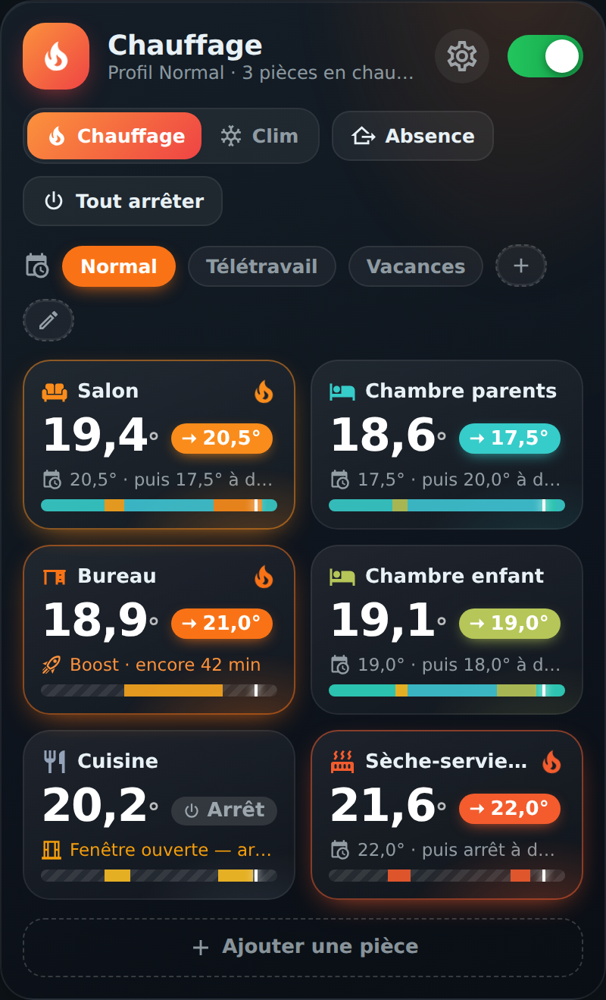
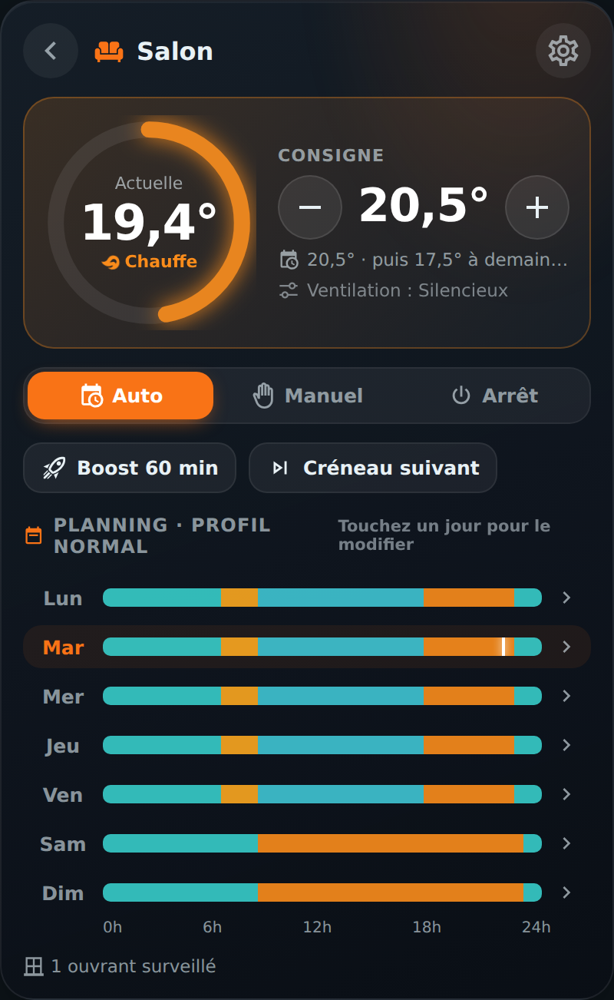
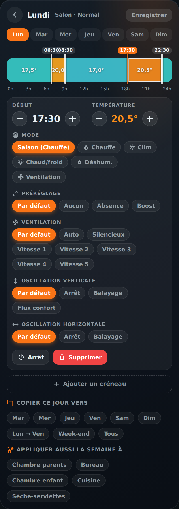
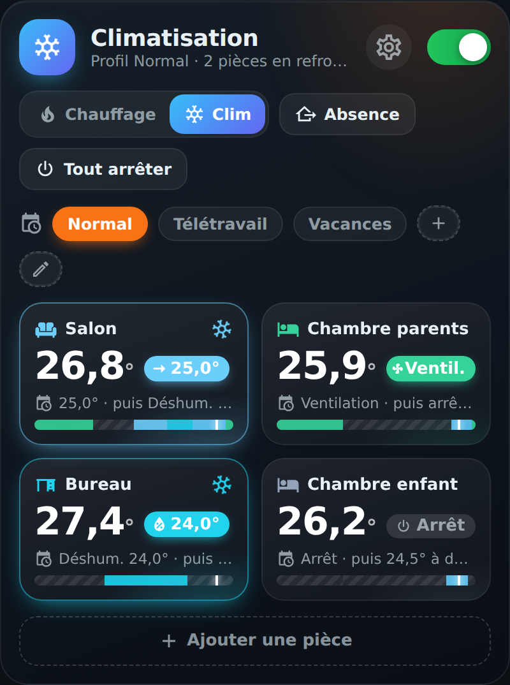
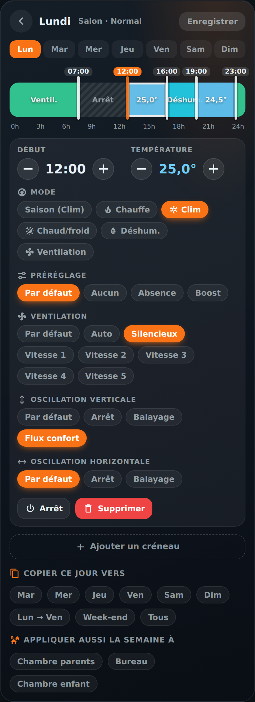

# 🌡️ Climat HOLM

[](https://hacs.xyz/)


🇫🇷 Français · [🇬🇧 English](README.en.md)

**Le chauffage et la clim de toute la maison, programmés pièce par pièce, dans une seule carte claire et animée.**

Climat HOLM est une intégration **Home Assistant** qui pilote vos radiateurs, pompes à chaleur, climatiseurs et sèche-serviettes (toute entité `climate`) selon un **planning par pièce**. Elle est livrée avec **sa propre carte Lovelace** : on voit toute la maison d'un coup d'œil, on modifie un horaire en faisant glisser une poignée, on lance un boost d'un toucher.

> ✨ **Zéro YAML.** On ajoute l'intégration, on crée ses pièces depuis la carte, et tout se règle au doigt : horaires, températures, modes, ventilation, profils.

### En bref

- 👀 **Voir d'un coup d'œil** : une tuile par pièce avec la température actuelle, la consigne, ce qui se passe (« 20,5° · puis 17,5° à 22:30 »), la frise du jour et une animation quand ça chauffe ou refroidit.
- ✍️ **Modifier facilement** : une frise de 0 h à 24 h par jour ; on fait glisser les poignées (pas de 5 min), on règle début et fin au quart d'heure, on touche une plage pour régler sa température, on copie une journée vers d'autres jours ou d'autres pièces.
- ❄️ **Chauffage et clim** : un interrupteur de saison Chauffage / Clim, et chaque créneau peut imposer son **mode** (chauffe, clim, chaud/froid, déshumidification, ventilation seule).
- 🌀 **Options des appareils** : ventilation (auto, silencieux, vitesses), oscillation verticale et horizontale, préréglage (éco, confort, boost…), par pièce ou par créneau. La carte ne propose que ce que vos appareils savent faire.
- ⚡ **Actions rapides** : Boost, Créneau suivant, Revenir au planning, mode Auto / Manuel / Arrêt, et pour toute la maison : Absence et Tout arrêter.
- 🗂️ **Profils** : Normal, Télétravail, Vacances… un planning complet par profil, qu'on bascule d'un toucher.
- 🪟 **Fenêtres** : arrêt automatique d'une pièce quand une fenêtre reste ouverte (délai réglable).
- 🌡️ **Sonde au choix** : la température d'une pièce peut venir d'un capteur plus fiable que celui du radiateur, et la consigne des appareils peut être **ajustée d'après cette sonde**.
- 📈 **La journée en un coup d'œil** : un graphique avec la programmation de toutes les pièces.
- 🤖 **Prêt pour vos automatisations** : un thermostat par pièce, des interrupteurs, des listes et des actions (services).
- 🔁 **Import depuis Climate Scheduler** : vos plannings existants sont repris en un clic.

| Vue d'ensemble | Une pièce | Une journée |
|---|---|---|
|  |  |  |

| Saison clim | Mode et options d'un créneau |
|---|---|
|  |  |


### 🆕 Nouveautés de la 1.4.0

- 🎚️ **Préréglages Confort, Éco, Hors-gel et Absent** ([#3](https://github.com/kaaribou/climat-holm/issues/3), idée de Mimic33) : dans chaque pièce, et sur son thermostat `climate.holm_<pièce>`, même si l'appareil réel n'a aucun préréglage. Plus besoin d'un thermostat virtuel juste pour ça. Températures dans les réglages, chauffage et clim. Voir [Préréglages](#préréglages).
- 🌡️ **La correction d'après la sonde ne freine plus le démarrage** ([#3](https://github.com/kaaribou/climat-holm/issues/3)) : tant que la pièce n'a pas atteint sa consigne, la consigne envoyée n'est plus jamais baissée en chauffage (ni montée en clim). Une clim murale qui lit trop bas au démarrage chauffe donc à pleine puissance. Voir [Ajuster la consigne d'après la sonde](#ajuster-la-consigne-daprès-la-sonde).
- 🧭 Nouvelle action `climat_holm.set_preset`, pour une pièce ou toute la maison.

### Nouveautés de la 1.3.0

- 🌡️ **Consigne ajustée d'après la sonde** ([#2](https://github.com/kaaribou/climat-holm/issues/2), idée d'olivr2s) : une clim ou un radiateur mesure souvent mal la température de la pièce. Cochez **Ajuster la consigne des appareils d'après la sonde** dans les réglages d'une pièce : Climat HOLM corrige la consigne envoyée de l'écart entre le thermomètre de l'appareil et la sonde. Voir [Ajuster la consigne d'après la sonde](#ajuster-la-consigne-daprès-la-sonde).
- 📈 **Programmation du jour** : sous les pièces, un graphique montre la consigne de chaque pièce de 0 h à 24 h, avec l'heure actuelle, le détail au survol et, en option, la température réelle. Un clic sur une pièce de la légende la masque, un double-clic n'affiche qu'elle. Voir [Programmation du jour](#programmation-du-jour).

### Nouveautés de la 1.2.0

- 🌍 **8 langues** : l'intégration (configuration, options, entités, actions) est traduite en français, anglais, allemand, espagnol, italien, néerlandais, portugais et polonais, selon la langue de Home Assistant. La carte **HOLM Climat** aussi, éditeur compris ; son option `language` permet d'imposer une langue.
- 🇬🇧 README en anglais.

---

## Sommaire

- [Installation](#installation)
- [Premiers pas](#premiers-pas)
- [La carte](#la-carte)
- [Qui décide de la consigne ?](#qui-décide-de-la-consigne-)
- [Entités créées](#entités-créées)
- [Actions (services)](#actions-services)
- [Réglages](#réglages)
- [FAQ / dépannage](#faq--dépannage)

---

## Installation

### Avec HACS (recommandé)

1. HACS → menu ⋮ → **Dépôts personnalisés**.
2. Ajoutez `https://github.com/kaaribou/climat-holm`, catégorie **Intégration**.
3. Recherchez **Climat HOLM** → **Télécharger**.
4. **Redémarrez Home Assistant.**

### Manuellement

1. Copiez le dossier `custom_components/climat_holm` dans le dossier `config/custom_components/` de Home Assistant.
2. Redémarrez Home Assistant.

> [!NOTE]
> La carte est **fournie avec l'intégration** : pas besoin de l'installer à part ni d'ajouter de ressource, elle est enregistrée automatiquement.

---

## Premiers pas

1. **Paramètres → Appareils et services → Ajouter une intégration → Climat HOLM.**
2. Choisissez éventuellement vos appareils (une pièce sera créée par appareil) et, si vous utilisez Climate Scheduler, cochez **Importer mes plannings**. Vous pourrez aussi les importer plus tard : carte → ⚙️ **Réglages** → **Importer depuis Climate Scheduler**. Seul Climate Scheduler est importé ; avec un autre outil (Scheduler, automatisations…), recréez vos créneaux dans la carte.
3. Laissez **« Démarrer la programmation »** décoché si vous voulez d'abord tout vérifier : tant que la programmation est en pause, Climat HOLM **ne commande aucun appareil**.
4. Ajoutez la carte **Climat HOLM** à un tableau de bord depuis le sélecteur de cartes :

```yaml
type: custom:holm-climat-card
```

5. Créez ou ajustez vos pièces et vos plannings dans la carte, puis activez la programmation avec l'interrupteur en haut à droite.

> [!IMPORTANT]
> Un seul programmateur à la fois : si un autre outil (Climate Scheduler, automatisations, planning intégré à l'appareil…) pilote déjà les mêmes appareils, désactivez-le pour éviter qu'ils se contredisent.

---

## La carte

### Vue d'ensemble

- En-tête : saison, état de la programmation, bouton **Réglages** et interrupteur **Programmation**.
- **Chauffage / Clim** : change la saison, donc le mode utilisé par défaut par tous les créneaux.
- **Absence** : toutes les pièces passent à la température d'absence (et la clim s'arrête, si vous le souhaitez).
- **Tout arrêter** : arrêt général, sans toucher aux plannings.
- **Profils** : touchez un profil pour l'activer ; **+** crée un profil (copie du profil actif), ✏️ le renomme ou le supprime.
- Une tuile par pièce ; un toucher ouvre la pièce. Si la consigne est ajustée d'après la sonde, la tuile l'indique (« Sonde 21,0° · correction +1,5° »).
- Sous les tuiles, le graphique **Programmation du jour** (voir ci-dessous).

### Programmation du jour

Le graphique montre d'un coup d'œil la programmation de toutes les pièces pour aujourd'hui, dans le profil actif. Il est replié au départ : touchez son titre pour l'ouvrir ou le fermer (le choix est retenu par le navigateur).

- **Un trait par pièce**, de sa couleur : la consigne programmée de 0 h à 24 h. Un **trou** dans le trait, c'est un arrêt. Une pièce en **Arrêt** n'a pas de trait ; une pièce en **Manuel** montre sa consigne manuelle toute la journée. Quand plusieurs pièces ont la même consigne, leurs traits sont décalés de quelques pixels pour rester tous visibles.
- **Le trait orange vertical** : l'heure actuelle.
- **Au survol** (ou au toucher), une bulle donne l'heure et la consigne de chaque pièce, et sa température mesurée.
- **La légende** : un clic sur une pièce la masque ou la réaffiche, un double-clic n'affiche qu'elle ; **Tout afficher** les remet toutes. Les pièces en Arrêt ou en Manuel y sont signalées.
- **Température réelle** : ajoute en pointillés la température mesurée aujourd'hui dans chaque pièce, pour voir si elle suit son programme. Désactivée au départ, pour ne pas surcharger le graphique ; elle est plus lisible avec une ou deux pièces affichées.
- Les dérogations (+/-, créneau suivant), les boosts et les absences ne sont pas tracés : le graphique montre le programme.
- L'option `day_chart` de la carte permet de l'ouvrir d'office (`open`) ou de le masquer (`hide`).

### Une pièce

- Jauge de température, **consigne +/-** : la nouvelle consigne vaut jusqu'au prochain créneau, puis le planning reprend.
- **Auto** (planning), **Manuel** (consigne fixe, avec son propre mode et ses options) ou **Arrêt**.
- **Préréglages** : Confort, Éco, Hors-gel, Absent (voir ci-dessous).
- **Boost** (durée réglable), **Créneau suivant**, **Revenir au planning**.
- La semaine en frises ; touchez un jour pour le modifier. La roue dentée ouvre les réglages de la pièce : nom, icône, appareils, sonde (et ajustement de la consigne d'après la sonde), fenêtres, options par défaut des appareils.
- Sous les frises, la sonde utilisée et, si l'ajustement est actif, la correction en cours.

### Préréglages

Sous Auto / Manuel / Arrêt, une rangée de boutons applique un préréglage à la pièce, même si l'appareil réel n'en propose aucun :

| Bouton | Chauffage | Clim |
|---|---|---|
| 🛋️ **Confort** | Température Confort (19,5 °C par défaut) | Confort clim (24 °C) |
| 🍃 **Éco** | Température Éco (17 °C) | Éco clim (26 °C) |
| ❄️ **Hors-gel** | Température hors-gel (7 °C) | Arrêt |
| 🚪 **Absent** | Température d'absence (16 °C) | Arrêt (ou Éco clim si « Arrêter la clim pendant une absence » est décoché) |

- Le préréglage **remplace le planning** jusqu'à ce qu'on l'annule : touchez de nouveau le bouton allumé, ou **Revenir au planning**. Changer de mode (Auto / Manuel / Arrêt) ou de consigne l'annule aussi.
- La ligne d'état de la pièce et sa tuile l'indiquent (« Éco · 17,0° »).
- Les températures se règlent dans les **Réglages** (⚙️ → *Préréglages*), une fois pour toutes les pièces.
- Le thermostat `climate.holm_<pièce>` propose les mêmes préréglages (plus Boost) : vous pouvez les choisir depuis une carte thermostat, la voix ou une automatisation, et l'action `climat_holm.set_preset` les applique à une pièce ou à toutes.
- Priorité : fenêtre ouverte, arrêt, boost et absence générale passent avant le préréglage ; le préréglage passe avant le mode Manuel, les consignes temporaires et le planning.

### Ajuster la consigne d'après la sonde

Une clim mesure la température près de son appareil (souvent en hauteur), un radiateur près de sa résistance : leur thermomètre se trompe souvent de 1 ou 2 °C sur la température réelle de la pièce. Avec une **sonde de température** dans la pièce et l'option **Ajuster la consigne des appareils d'après la sonde**, Climat HOLM corrige cet écart :

> consigne envoyée à l'appareil = consigne programmée + (température lue par l'appareil − température de la sonde)

**Exemple** : programmé 21 °C, la clim lit 22,5 °C mais la sonde 21 °C. La clim reçoit 22,5 °C et s'arrête donc quand la pièce est vraiment à 21 °C. Pour un radiateur qui lit 18,5 °C quand la pièce est à 19,5 °C, la consigne est baissée de 1 °C.

**Jamais de frein au démarrage** (1.4.0) : une clim murale lit souvent trop bas quand elle démarre (son thermomètre est près du mur froid). La formule baisserait alors la consigne et la clim démarrerait mollement. Désormais, **tant que la pièce n'a pas atteint sa consigne, la consigne envoyée n'est jamais baissée en chauffage, ni montée en clim**. La correction ne sert alors qu'à aller plus fort, ou à s'arrêter au bon moment une fois la pièce à température.

> Exemple : programmé 19 °C, la clim lit 13,5 °C et la sonde 16 °C. Avant, la clim recevait 16,5 °C ; maintenant elle reçoit 19 °C. Quand la pièce dépasse 19 °C, la correction reprend normalement.

Pour rester simple et éviter que l'appareil change sans arrêt :
- la correction est limitée à **±3 °C** et arrondie au pas de l'appareil (souvent 0,5 °C) ;
- elle change **au plus toutes les 10 minutes**, et seulement si elle varie d'au moins un pas ;
- elle ne s'applique qu'au **programme** (créneaux, consignes temporaires, boost, absence), pas en mode **Manuel**, ni quand la pièce est à l'arrêt ;
- si la sonde ou l'appareil ne donne plus de température, l'appareil reçoit la **consigne normale**.

La carte affiche toujours la consigne voulue (21 °C dans l'exemple) ; la correction apparaît sur la tuile et dans la pièce. Ce n'est pas une régulation complète (anticipation, PID…) : pour cela, voyez [Versatile Thermostat](https://github.com/jmcollin78/versatile_thermostat).

### Une journée

- Faites **glisser les poignées** pour changer les horaires (pas de 5 min), ou réglez **Début** et **Fin** avec − / + (au quart d'heure).
- Passez d'un créneau à l'autre avec les flèches ‹ › du panneau (ou ← → au clavier), pratique pour les petits créneaux. Un toucher sur une poignée sélectionne aussi son créneau.
- **Touchez une plage** pour régler son heure de début et de fin, sa température ou l'arrêt, son **mode** et ses **options** : préréglage, ventilation, oscillation verticale et horizontale. « Par défaut » reprend le réglage de la pièce.
- **Ajouter un créneau** coupe la plage choisie (ou la plus longue) en deux.
- **Copier ce jour vers** d'autres jours (Lun → Ven, Week-end, Tous) et **Appliquer aussi la semaine à** d'autres pièces.
- **Enregistrer** : rien n'est envoyé tant que vous n'avez pas enregistré.

Chaque plage affiche son mode, sa consigne et ses options (ex. « Ventil. · Vitesse 1 · Balayage »). Sur les frises, la couleur suit la température (bleu → ambre → rouge en chauffage) et le mode : bleu pour la clim, cyan pour la déshumidification, vert pour la ventilation, hachures pour l'arrêt.

### Options de la carte

| Option | Description | Par défaut |
|---|---|---|
| `language` | Langue de la carte : `fr`, `en`, `de`, `es`, `it`, `nl`, `pt`, `pl` | celle du profil |
| `title` | Titre de l'en-tête | Chauffage / Climatisation |
| `rooms` | Limiter la carte à certaines pièces | toutes |
| `theme` | `auto`, `dark`, `light` ou `theme` (couleurs de votre thème) | `auto` |
| `day_chart` | Graphique **Programmation du jour** : `collapsed` (replié, s'ouvre d'un clic), `open` (ouvert) ou `hide` (masqué) | `collapsed` |
| `day_chart_real` | Afficher la température réelle dans ce graphique dès le départ | `false` |

---

## Qui décide de la consigne ?

Pour chaque pièce, la première règle qui s'applique l'emporte :

| Priorité | Situation | Résultat |
|---|---|---|
| 1 | Programmation en pause | Climat HOLM ne touche à rien |
| 2 | **Tout arrêter** | Arrêt |
| 3 | Fenêtre ouverte depuis plus que le délai | Arrêt |
| 4 | Pièce en **Arrêt** | Arrêt |
| 5 | **Boost** en cours | Température du boost |
| 6 | **Absence** | Température d'absence (ou arrêt de la clim) |
| 7 | Pièce en **Manuel** | Consigne, mode et options du mode manuel |
| 8 | Consigne temporaire (+/-, créneau suivant) | Jusqu'au prochain créneau |
| 9 | **Planning** du profil actif | Créneau en cours |

Climat HOLM n'envoie une commande que lorsque quelque chose change, et respecte les limites de chaque appareil (températures mini / maxi, pas de réglage, modes et options disponibles).

---

## Entités créées

| Entité | Rôle |
|---|---|
| `climate.holm_<pièce>` | Thermostat de la pièce : Auto / saison / Arrêt, consigne, préréglages Confort, Éco, Hors-gel, Absent et Boost. Attributs : source, fin de dérogation, prochain changement, fenêtre ouverte, profil |
| `switch.climat_holm_programmation` | Active / met en pause toute la programmation |
| `switch.climat_holm_absence` | Mode absence |
| `switch.climat_holm_tout_arreter` | Arrêt général |
| `select.climat_holm_profil` | Profil actif |
| `select.climat_holm_saison` | Chauffage / Climatisation |

## Actions (services)

| Action | Description |
|---|---|
| `climat_holm.boost` | Boost d'une ou plusieurs pièces (`minutes`, 0 pour arrêter) |
| `climat_holm.next_slot` | Passe au créneau suivant |
| `climat_holm.cancel_override` | Revient au planning |
| `climat_holm.set_preset` | Applique un préréglage (`comfort`, `eco`, `frost`, `away`, ou `none` pour revenir au planning) à une ou plusieurs pièces, ou à toutes si aucune n'est indiquée |
| `climat_holm.set_profile` | Change de profil |
| `climat_holm.set_away` | Active / désactive l'absence (avec une date de fin facultative) |

Exemple : toute la maison en Éco.

```yaml
action: climat_holm.set_preset
data:
  preset: eco
```

Exemple : passer en profil Vacances au départ.

```yaml
action: climat_holm.set_profile
data:
  profile: Vacances
```

---

## Réglages

Depuis la carte (⚙️) ou **Paramètres → Appareils et services → Climat HOLM → Configurer** :

| Réglage | Par défaut |
|---|---|
| Température et durée du boost | 21 °C · 60 min |
| Température en absence | 16 °C |
| Consigne du mode manuel | 19,5 °C |
| Délai avant arrêt si fenêtre ouverte | 60 s |
| Arrêter la clim pendant une absence | oui |
| Préréglages Confort · Éco · Hors-gel (chauffage) | 19,5 · 17 · 7 °C |
| Préréglages Confort · Éco (clim) | 24 · 26 °C |

---

## FAQ / dépannage

| Problème | Solution |
|---|---|
| Rien ne se passe | Vérifiez que la **programmation** est activée (interrupteur en haut de la carte). |
| Un appareil ne suit pas le planning | Un autre outil le pilote peut-être aussi (planning de l'appareil, automatisation, autre intégration). |
| Une option n'apparaît pas | La carte ne montre que les modes et options que l'appareil annonce à Home Assistant. |
| Un radiateur s'arrête en saison Clim | Normal : un appareil qui ne sait pas refroidir est arrêté en saison Clim, sauf si le créneau impose un mode qu'il connaît (Chauffe). |
| La pièce n'atteint pas la bonne température alors que l'appareil croit l'avoir atteinte | Ajoutez une sonde à la pièce et cochez **Ajuster la consigne des appareils d'après la sonde**. |
| Ma clim démarre mollement avec la correction d'après la sonde | Corrigé en 1.4.0 : la consigne n'est plus baissée tant que la pièce n'a pas atteint sa température. |
| Importer mes plannings Climate Scheduler après l'installation | Carte → ⚙️ **Réglages** → bouton **Importer depuis Climate Scheduler** (en bas). Il n'apparaît que si l'intégration Climate Scheduler est installée. Les autres outils (Scheduler, automatisations…) ne sont pas importés : recréez les créneaux dans la carte, c'est rapide. |
| La correction de la sonde ne bouge pas | Normal pendant 10 minutes après un changement, et tant que l'écart varie de moins d'un pas de l'appareil. Elle est inactive en mode Manuel et à l'arrêt. |
| La nouvelle version de la carte ne s'affiche pas | Videz le cache (Ctrl + F5, ou « Recharger les ressources » dans l'application mobile). |

---

## Un petit merci ?

L'intégration vous plaît ? Vous pouvez m'offrir une bière 🍺

[](https://paypal.me/kaaribou)

---

## Crédits & licence

- Code : licence **MIT** — © kaaribou. Voir le [CHANGELOG](CHANGELOG.md).
- Icônes : [Material Design Icons](https://pictogrammers.com/library/mdi/).

Fait partie de **HOLM — Home Orchestration & Living Management** : la gestion et l'orchestration intelligente de la maison.

Les autres projets : [Volets HOLM](https://github.com/kaaribou/volets-holm) · [Carburant HOLM](https://github.com/kaaribou/carburant-holm) · [Commandes à la maison HOLM](https://github.com/kaaribou/commandes-holm) · [HOLM LaMetric](https://github.com/kaaribou/lametric-holm) · [HOLM My Menu](https://github.com/kaaribou/holm-mymenu) · [HOLM Lektrico](https://github.com/kaaribou/lektrico-holm) · [HOLM GitHub](https://github.com/kaaribou/github-holm) · [HOLM Cars](https://github.com/kaaribou/holm-cars) · [HOLM HP/HC](https://github.com/kaaribou/holm-tarif) · [HOLM Navbar Card](https://github.com/kaaribou/holm-navbar-card) · [HOLM Climate Card](https://github.com/kaaribou/climate-card-holm) · [HOLM Music Card](https://github.com/kaaribou/holm-music-card) · [HOLM Sentinel Card](https://github.com/kaaribou/holm-sentinel-card) · [HOLM Security Card](https://github.com/kaaribou/holm-security-card) · [HOLM Recordings Card](https://github.com/kaaribou/holm-recordings-card) · [HOLM Covers Card](https://github.com/kaaribou/holm-covers-card) · [HOLM Runtime Card](https://github.com/kaaribou/holm-runtime-card) · [HOLM Power Flow Card](https://github.com/kaaribou/holm-power-flow-card) · [HOLM Energy Cards](https://github.com/kaaribou/holm-energy-cards) · [HOLM Radiator Card](https://github.com/kaaribou/holm-radiator-card) · [HOLM Floor Card](https://github.com/kaaribou/holm-floor-card) · [HOLM Ecojoko Card](https://github.com/kaaribou/holm-ecojoko-card) · [HOLM Smoke Card](https://github.com/kaaribou/holm-smoke-card) · [HOLM Family Card](https://github.com/kaaribou/holm-family-card) · [HOLM Live Power Card](https://github.com/kaaribou/holm-live-power-card) · [HOLM Solar Optimizer Card](https://github.com/kaaribou/holm-solar-optimizer-card) · [HOLM Govee Light Card](https://github.com/kaaribou/holm-govee-light-card) · [HOLM Leapmotor Card](https://github.com/kaaribou/holm-leapmotor-card). · [HOLM Poubelles](https://github.com/kaaribou/holm-bins) · [HOLM FX](https://github.com/kaaribou/holm-fx-card) · [HOLM Theme Editor](https://github.com/kaaribou/holm-theme)
